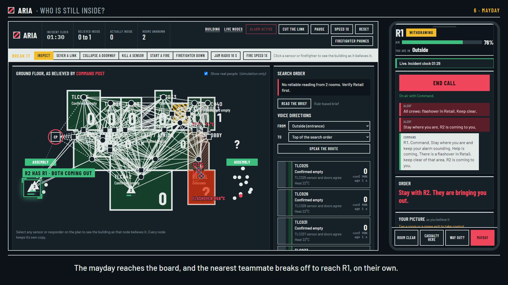

# ARIA

**Who is still inside, even when the building is burning around the answer.**

Solo entry for [DurHack 2026](https://durhack-26.devpost.com/), Durham, 14-15 November 2026. Tracks: Neptune North (primary), Accenture, the overall prizes, MLH Best Use of ElevenLabs, MLH Best Use of Gemini API.

**Live demo:** https://durhack-2026-production.up.railway.app



At a building fire, the incident commander keeps deciding whether to send crews in or fight from outside, and that depends on one question: who is still inside, and where? ARIA gives every sensor and every firefighter **its own copy of the picture**. They share what they see whenever they can hear each other, and keep deciding from what they last heard when they cannot. A room nobody can hear from turns **unknown, never empty**. When the radio comes back, the copies agree again.

- **Photo → building:** Gemini reads the fire evacuation plan from a photo; ARIA repairs it and keeps the photo underneath for checking.
- **No central server:** every record has one writer; copies merge in any order; ages instead of timestamps, so clocks never need to agree.
- **Search without radio traffic:** each firefighter computes the same search order from its own copy.
- **Break it:** cut or jam the radio, collapse doors, kill sensors, start fires, put a firefighter down. The fire spreads, sensors burn and firefighters run on limited air.
- **Firefighter phone:** order, route, air, their own picture and radio messages; room clear, casualty here, way out, mayday; tap a room to steer (unsafe orders are refused, with the reason).
- **Talk to Command:** a live ElevenLabs voice agent that answers only from that firefighter's live data and can be interrupted.
- **Commander's brief:** written by Gemini, read by ElevenLabs, and thrown away if it calls any unconfirmed room empty.

| Measured over 100 simulated fires ([details](docs/evaluation.md)) | |
|---|---|
| Occupied room shown as confirmed empty | 0.353% of 469,196 checks |
| Rooms wrongly empty at the end of a run | 0 of 100 |
| Sensors destroyed by the end | 56.8% |
| Agreement after the link returns | mean 11.1 s |

Simulation figures with assumed sensor error rates. This is a decision-support prototype, not a certified life-safety system.

## For judges and readers

- [Devpost write-up](DEVPOST.md)
- [Judging guide](docs/judging-guide.md): every button, a demo script per track, why no central server, Q&A
- [Evaluation](docs/evaluation.md): method, results, what is still weak
- Demo video: run `node scripts/record-demo.mjs` to record it (see below); screenshots are in [docs/screenshots](docs/screenshots)
- [Design spec](docs/superpowers/specs/2026-11-14-roll-call-design.md) and [sponsor challenges](docs/challenges.md)

## Run it

No build step and no dependencies (Node 22 or newer):

```bash
node server.js
```

| Page | What it is |
|---|---|
| http://localhost:8200 | The simulation and the command board: the plan, search order, brief, voice directions, live measures, what each node believes, the log, and the **Break it** toolbar. |
| http://localhost:8200/editor.html | The building editor: draw rooms, doors and exits, or import a photo of a floor plan (needs Gemini). **Use this building** makes every page use your layout. |
| `firefighter.html` | The firefighter phone. On the board press **Firefighter phones** and scan the code. Both devices must use the hosted HTTPS address, and the microphone for **Talk to Command** also needs HTTPS. |

Tests: `npm test` (53 tests). Safety measurement: `node scripts/evaluate.js 100`.

Optional keys go in `.env` (copy `.env.example`):
- **Gemini** (see below) for the layout import, the written brief and the route wording.
- **`ELEVENLABS_API_KEY`** for every voice. For **Talk to Command**, also run `node scripts/setup-voice-agent.js` once and set `ELEVENLABS_AGENT_ID`.

Without the keys, the brief is rule-based and the browser's own voice reads it.

### The demo video and screenshots

```bash
node scripts/make-music.mjs
```
```bash
node scripts/record-demo.mjs
```
```bash
node scripts/demo-screenshots.mjs
```

1. `make-music.mjs` makes a background track with ElevenLabs Music. It is optional.
2. `record-demo.mjs` runs `demo.html` in a headless Chromium and records it. It needs ffmpeg and a Playwright Chromium. Every voice comes from ElevenLabs, and Command's replies come from the live agent. The waits are cut from the picture and the sound together, and the video is written to `demo-video/aria-demo.mp4`.
3. `demo-screenshots.mjs` takes screenshots from that video into `docs/screenshots/`.

## Gemini through Vertex AI

ARIA can call Gemini three ways, set with `GEMINI_PROVIDER`. All three give the same layout import, brief and route wording.

| `GEMINI_PROVIDER` | What you need | Billed to |
|---|---|---|
| `aistudio` (default) | An AI Studio API key in `GEMINI_API_KEY` | Your AI Studio project |
| `vertex-express` | A Vertex AI API key in `VERTEX_API_KEY` (or `GEMINI_API_KEY`) | Your Google Cloud project |
| `vertex` | `GCP_PROJECT` plus a service account or `gcloud` sign-in | Your Google Cloud project |

**Quickest route, `vertex-express`:** put the key in `.env`, set `GEMINI_PROVIDER=vertex-express`, then enable the Vertex AI API once for the key's project at `https://console.cloud.google.com/apis/library/aiplatform.googleapis.com` (the project needs billing or credits). If it is not enabled, `node scripts/check-gemini.js` says so and links to the right page.

**Full route, `vertex`:**

1. In Google Cloud, create or pick a project with billing or credits, and enable the API:

```bash
gcloud config set project YOUR_PROJECT_ID
```
```bash
gcloud services enable aiplatform.googleapis.com
```

2. Sign in. On your own machine:

```bash
gcloud auth application-default login
```

   On a server, create a service account instead and keep its key file private:

```bash
gcloud iam service-accounts create aria
```
```bash
gcloud projects add-iam-policy-binding YOUR_PROJECT_ID --member="serviceAccount:aria@YOUR_PROJECT_ID.iam.gserviceaccount.com" --role="roles/aiplatform.user"
```
```bash
gcloud iam service-accounts keys create service-account-key.json --iam-account=aria@YOUR_PROJECT_ID.iam.gserviceaccount.com
```

3. In `.env` set `GEMINI_PROVIDER=vertex`, `GEMINI_MODEL=gemini-3.5-flash`, `GCP_PROJECT=YOUR_PROJECT_ID`, `GCP_LOCATION=global`, and for a server `GOOGLE_APPLICATION_CREDENTIALS=/opt/aria/service-account-key.json`.
4. Check it: `node scripts/check-gemini.js`.

Key files are git-ignored. Copy one to a server by itself with `scp`, never inside the project folder you deploy.

On a host that only takes variables (Railway, for example), put the whole key JSON in `GOOGLE_CREDENTIALS_JSON` instead of a file path. Google Cloud credits pay for Vertex AI but not for AI Studio, which has its own prepaid balance.

## Hosting

The live demo runs on **Railway**: connect the repository, add the variables from `.env.example` in the Railway dashboard, and generate a domain under Settings → Networking. See [RAILWAY_DEPLOY.md](RAILWAY_DEPLOY.md).

**Alternative, any Ubuntu server (for example Vultr):**

```bash
bash deploy/deploy.sh <server-ip> .env
```

It installs Node 22 and Caddy, runs ARIA as a service, and serves it over HTTPS at `https://<ip-with-dashes>.sslip.io`. No domain is needed. Re-run it to update.

The server keeps no picture of the building: the relay only forwards messages between devices. The Gemini and ElevenLabs proxies keep the keys on the server and are limited to 120 requests a minute per address.

## Layout

- `src/core/` replicated state, belief rules, hazard belief, search assignment, routing and directions, building layout and photo-import repair (tested)
- `src/sim/` the incident: people, sensors, firefighters, fire, smoke, air, radio
- `src/ui/` the command board, brief, radio and AI helpers
- `src/ff/` the firefighter phone and the Talk to Command call
- `src/editor/` the building editor
- `src/server/gemini.js` Gemini on AI Studio or Vertex AI
- `src/demo/`, `demo.html` the recorded demo
- `src/live/`, `live.html` **experimental, not part of the submission:** camera nodes that count people on the device, and a spoken room report
- `server.js` static files, message relay, Gemini and ElevenLabs proxies
- `scripts/` evaluation, Gemini check, voice-agent setup, demo recording
- `test/` automated tests

## Future extensions

- Real sensors and cameras as nodes (the experimental `live.html` page is the start).
- Device-to-device radio (Wi-Fi, Bluetooth or LoRa) instead of the relay.
- Several floors.
- Testing the voice with a fire service in real breathing apparatus.

## Links

- Live demo: https://durhack-2026-production.up.railway.app
- Devpost: https://durhack-26.devpost.com/
- Opening slides: https://docs.google.com/presentation/d/1q3omTEBLCsSmGaBdDifoDqNkFxeMxge6hBS9LN3U38o
